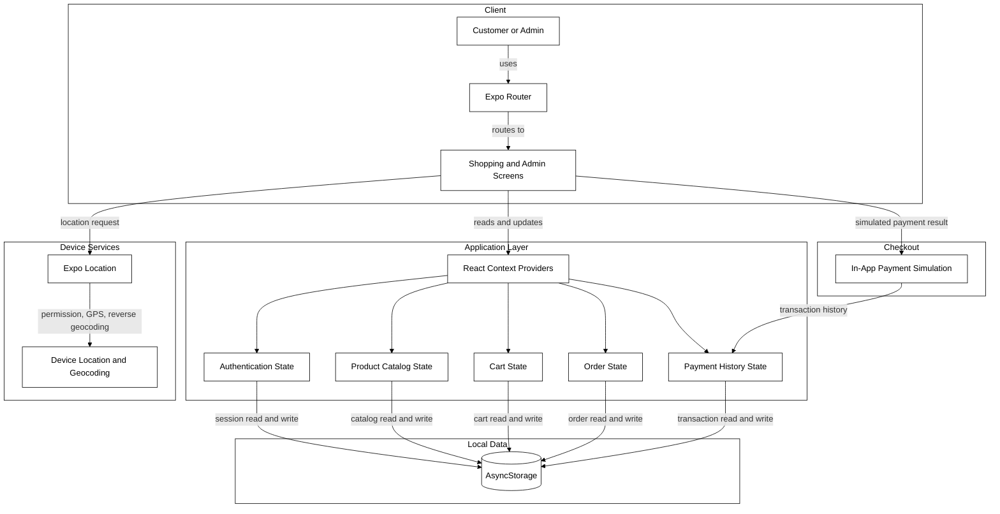
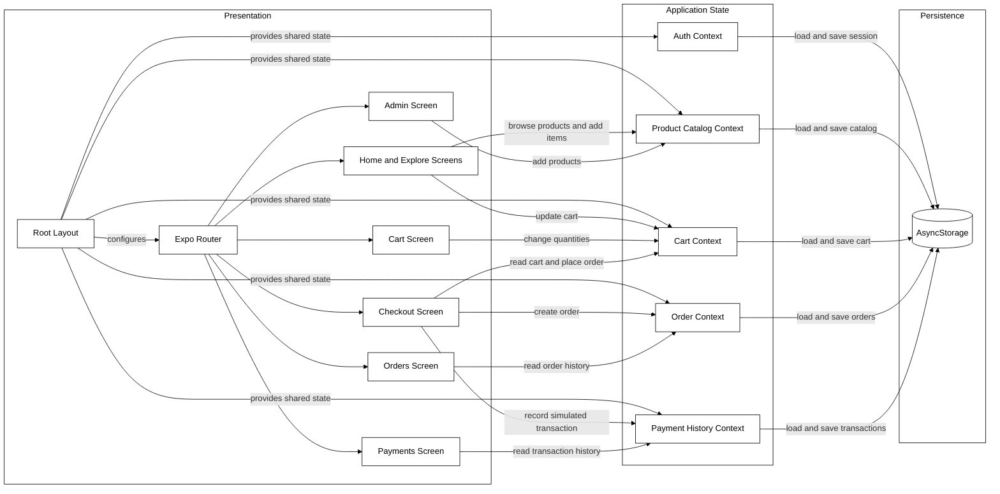

# Architecture Diagram

Cart Crusaders is a client-side grocery shopping app built with Expo and React Native for Android, iOS, and web. It uses React Context for application state and device-local storage; it does not currently have a backend service or a real payment gateway.

## Application Architecture

<!-- mermaid-checked: no \n, no em-dash/en-dash, no {} in labels, subgraphs are id["label"], arrows are -->|"label"|, all subgraphs closed by end, ids unique -->

### Technology Stack Summary

| Layer | Technology | Version | Purpose |
|---|---|---:|---|
| Application framework | Expo SDK | ^58.0.22 | App runtime, native modules, and build tooling |
| User interface | React Native | 0.88.1 | Shared Android and iOS interface |
| Web rendering | React Native Web | ~0.21.0 | Web target for React Native screens |
| UI runtime | React | 19.3.0 | Components, hooks, and context state |
| Navigation | Expo Router | ~58.0.29 | File-based screens and navigation |
| State persistence | AsyncStorage | 2.2.0 | Device-local session, catalog, cart, order, and payment history |
| Device location | Expo Location | ~58.0.20 | Foreground location and reverse geocoding |
| Animation runtime | Reanimated and Worklets | ^4.7.1 / 0.13.0 | Native-capable animation support |

### Data Storage & External Services

AsyncStorage stores application data locally on the device; there is no remote database or application API in the current project. Expo Location requests foreground permission, reads device coordinates, and attempts reverse geocoding on native platforms. Checkout records an in-app simulated payment outcome in local payment history; the displayed UPI options do not connect to payment providers.

### Key Architectural Decisions

- Expo Router defines screens and navigation; React Context providers supply shared application state.
- The product catalog, cart, orders, login session, and payment history persist locally using AsyncStorage.
- Checkout and payment processing are demonstrations without a backend, payment processor, or server-side order fulfillment.

## Component Relationships

<!-- mermaid-checked: no \n, no em-dash/en-dash, no {} in labels, subgraphs are id["label"], arrows are -->|"label"|, all subgraphs closed by end, ids unique -->

### Component Inventory

| Component | Layer | Type | Responsibility |
|---|---|---|---|
| Root Layout | Presentation | Expo Router layout | Loads fonts, configures navigation, and mounts shared providers |
| Home and Explore Screens | Presentation | Screens | Display and filter products; home can request device location |
| Cart Screen | Presentation | Screen | Displays cart contents and quantity controls |
| Checkout Screen | Presentation | Screen | Validates delivery details, simulates payment, and creates orders |
| Orders Screen | Presentation | Screen | Displays locally stored order history |
| Payments Screen | Presentation | Screen | Displays locally stored transaction history |
| Admin Screen | Presentation | Screen | Adds catalog products |
| Auth Context | Application State | React Context provider | Restores and updates the local user or admin session |
| Product Catalog Context | Application State | React Context provider | Seeds, restores, and updates product catalog state |
| Cart Context | Application State | React Context provider | Manages cart items, quantities, and totals |
| Order Context | Application State | React Context provider | Manages order history |
| Payment History Context | Application State | React Context provider | Manages simulated payment transactions |
| AsyncStorage | Persistence | Local key-value storage | Persists app state on the current device |
